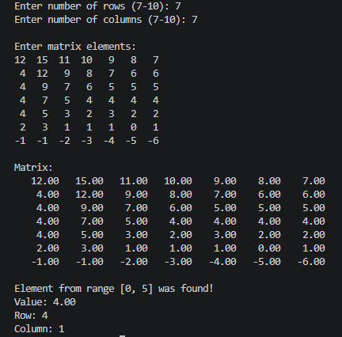
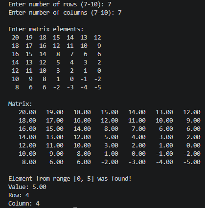
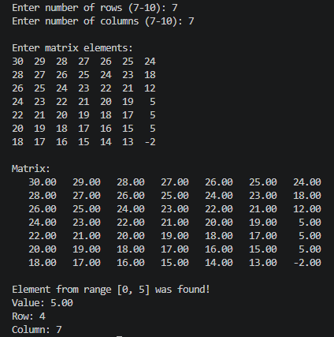
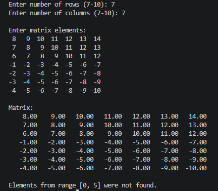

##### Міністерство освіти і науки України
##### Національний технічний університет України
##### «Київський політехнічний інститут імені Ігоря Сікорського»
##### Факультет інформатики та обчислювальної техніки

---

# Лабораторна робота №4
## з дисципліни «Структури даних та алгоритми»

---

##### Виконав
Студент групи: ІО-61  
Недашківський Артем Олександрович
Номер у списку групи: 19

##### Перевірив
Русінов Володимир Володимирович

###### Київ 2026

---

#### Мета лабораторної роботи:
Засвоєння теоретичного матеріалу та набуття практичних навичок розв'язання задачі пошуку заданої категорії елементів за допомогою різних алгоритмів методу двійкового пошуку у двовимірних масивах.
#### Постановка задачі:
1.Написати програму розв'язання задачі пошуку (за варіантом) у двовимірному масиві (матриці) методом двійкового пошуку. Конкретний алгоритм двійкового пошуку (№1 або №2) задається варіантом завдання.
2.Розміри матриці m та n взяти самостійно в межах від 7 до 10.
3.При тестуванні програми підбирати такі вхідні набори значень матриці, щоб можна було легко відстежити коректність виконання пошуку, і щоб ця коректність була протестована для всіх можливих випадків. З метою тестування дозволяється використовувати матриці меншого розміру.

---

## Завдання

Написати програму розв'язання задачі пошуку (за варіантом) у двовимірному масиві (матриці) методом двійкового пошуку. Конкретний алгоритм двійкового пошуку (№1 або №2) задається варіантом завдання.

## Умова завдання 
Задано матрицю дійсних чисел A[m,n]. Визначити присутність серед усіх елементів матриці будь-якого з чисел діапазону [0,5] і його місцезнаходження (координати) методом двійкового пошуку (Алгоритм №1), якщо елементи кожного стовпчика окремо впорядковані за незбільшенням.

---

### Варіант 19

---

### Результати тестування 1

### Результати тестування 2

### Результати тестування 3

### Результати тестування 4

---
#Висновок: Під час лабораторної роботи я навчився використовувати двійковий пошук для пошуку чисел у матриці. Перевірив роботу програми на різних прикладах: у першій матриці число 5 було знайдено, а в другій потрібних чисел не було. Програма працює правильно та швидко знаходить потрібні елементи.
